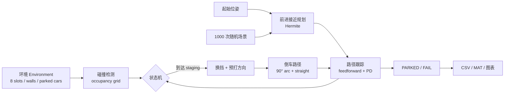
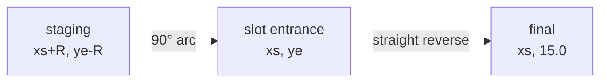
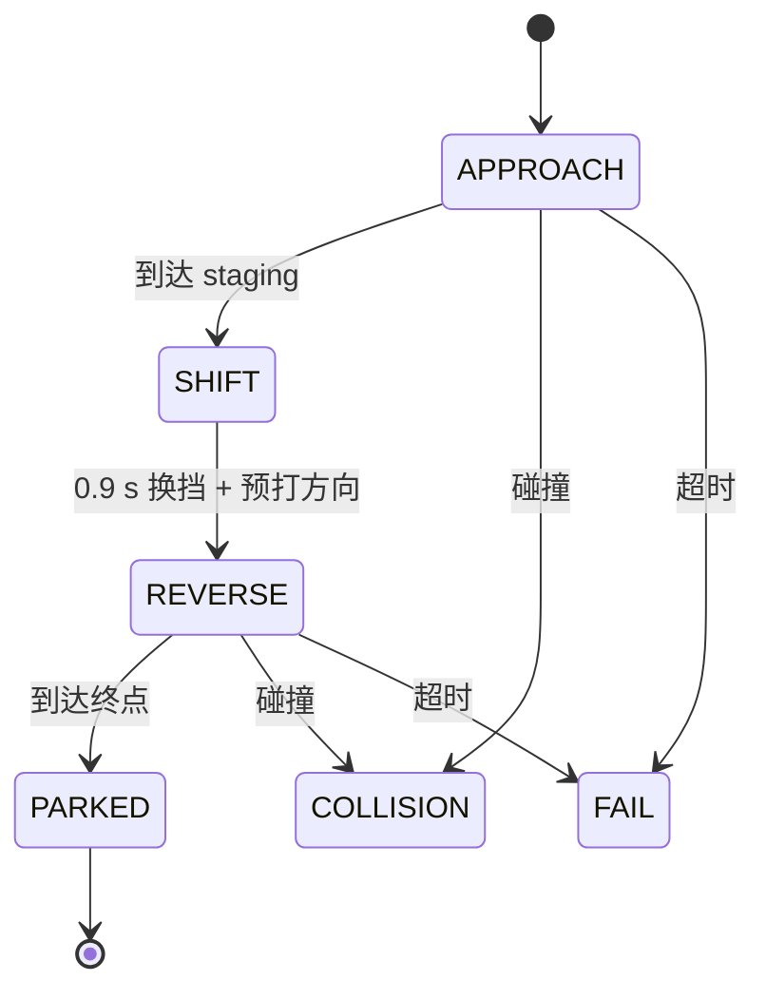

# 架构与算法说明

本文档解释 AutoParking MATLAB 的模块划分、倒车几何、控制律和 1000 次测试协议，方便二次开发与教学。

## 1. 数据流



## 2. 模块

| 模块 | 文件 | 职责 |
| --- | --- | --- |
| 配置 | `config/default_config.m` | 地图、车辆、车位、控制、测试参数 |
| 环境 | `env/build_parking_env.m` | 占用栅格、车位元数据、目标位姿 |
| 车辆 | `vehicle/vehicle_step.m` | 后轴自行车模型 + 转向速率限制 |
| 碰撞 | `vehicle/check_vehicle_collision.m` | fast / dense 两种车身采样 |
| 前进规划 | `planning/make_hermite_path.m` | 位置 + 航向双端约束 |
| staging | `planning/plan_approach.m` | 选择左/右接近，生成前进路径 |
| 倒车规划 | `planning/plan_reverse_path.m` | 90° 圆弧 + 直线 |
| 跟踪 | `control/track_path.m` | 前馈 + 横向/航向反馈 |
| 状态机 | `sim/run_parking_sim.m` | APPROACH → SHIFT → REVERSE → PARKED |
| 蒙特卡洛 | `sim/run_monte_carlo.m` | 1000 次批量测试与统计 |
| GUI | `parking_gui.m` + `gui/` | 随机/点击放置、虚拟小车、录制 |

## 3. 环境

- 地图 30 × 18 m，栅格分辨率 0.1 m。
- 8 个垂直车位：2.8 m 宽 × 5.2 m 深，入口 `y = 11.0 m`，后墙 `y = 16.2 m`。
- 车道 7.5 m 宽（`y = 3.5–11.0`）。
- 目标车位默认 4 号，中心 `x = 13.8 m`。
- 车辆 4.5 × 1.85 m，轴距 2.7 m，前后悬 0.9 m，最大前轮转角 35°。

最终倒车位姿：

```text
x = 13.8 m
y = 16.2 - 0.9 - 0.30 = 15.0 m
theta = -90°          % 车头朝车道
```

## 4. 前进接近

给定起始位姿 `P0 = (x0, y0, θ0)` 和 staging 位姿 `P1`，使用三次 Hermite：

```text
P(t) = h00 P0 + h10 m0 + h01 P1 + h11 m1
h00 = 2t³ - 3t² + 1
h10 = t³ - 2t² + t
h01 = -2t³ + 3t²
h11 = t³ - t²
m0 = d/3 · [cos θ0, sin θ0]
m1 = d/3 · [cos θ1, sin θ1]
```

staging：

```text
左接近：P1 = [xs + R, ye - R, 0]
右接近：P1 = [xs - R, ye - R, π]
R = 4.8 m
```

`R` 固定为 4.8 m，而不是从起始 y 反算，是为了保证前轮转角约 29.4°，给路径跟踪留出约 5.6° 修正余量。

## 5. 倒车几何

以左接近为例：

```text
圆弧圆心 C = [xs + R, ye]
起点       = [xs + R, ye - R]   θ = 0
终点       = [xs, ye]            θ = -90°
```

圆弧为顺时针 90°，之后沿车位中心线倒车到 `y = 15.0 m`。右接近为镜像。



## 6. 跟踪控制

统一控制律：

```text
δ = g·atan(L·κ) − g·kθ·eθ − klat·elat
```

- `g = +1` 前进，`g = -1` 倒车；
- `κ` 为路径曲率；
- `eθ = wrap(θ - θ_path)`；
- `elat` 为车身相对路径的横向误差；
- `kθ = 2.2`，`klat = 1.2`；
- 输出经 `±35°` 和 `40°/s` 限幅。

符号约定：

- 前馈项随挡位翻转；
- 航向项随挡位翻转；
- 横向项不翻转（打右方向永远让车相对路径向右）。

速度规划按剩余路径长度调度，并用 1 m/s² 的加速度限制平滑过渡。

## 7. 状态机



成功判据：

- 状态 `PARKED`；
- 全程无碰撞；
- 位置误差 ≤ 0.15 m；
- 航向误差 ≤ 3°。

## 8. 碰撞检测

- 占用栅格 0.1 m；
- 车身矩形外扩 0.08 m；
- 控制循环用 `fast`（约 130 个采样点）；
- 规划校验用 `dense`（0.15 m 网格，约 450 点）；
- 地图外视为障碍。

## 9. 1000 次蒙特卡洛

- `rng(2026)`；
- 起点 `y ∈ [5.8, 7.0]`，`x ∈ [1.5, 28.5]`；
- 航向 `0°/180° ± 20°`；
- 初始前轮 `±20°`；
- 倒车半径 4.8 m；
- 目标车位 4。

结果：1000/1000 成功，0 碰撞，0 规划失败，均值 2.68 cm / 0.54°。

## 10. 交互与录制

- 随机生成：`make_case` 采样可行起始位姿；
- 点击放置：`gui/click_to_start.m` 将点击坐标转为可行位姿；
- 虚拟小车：`gui/create_virtual_car.m` 绘制车身/车顶/车窗/车轮/灯光；
- 录制：`parking_gui` 中 `getframe` + `VideoWriter`，MP4 优先、AVI 回退。

## 11. 扩展建议

1. 用 Hybrid A* / Reeds–Shepp 支持任意起始位姿与斜列车位；
2. 加入执行器延迟、转向死区、里程计噪声；
3. 加入动态障碍与重规划；
4. 接入感知/定位或 HIL；
5. 把固定圆弧替换为可搜索的倒车路径族。
